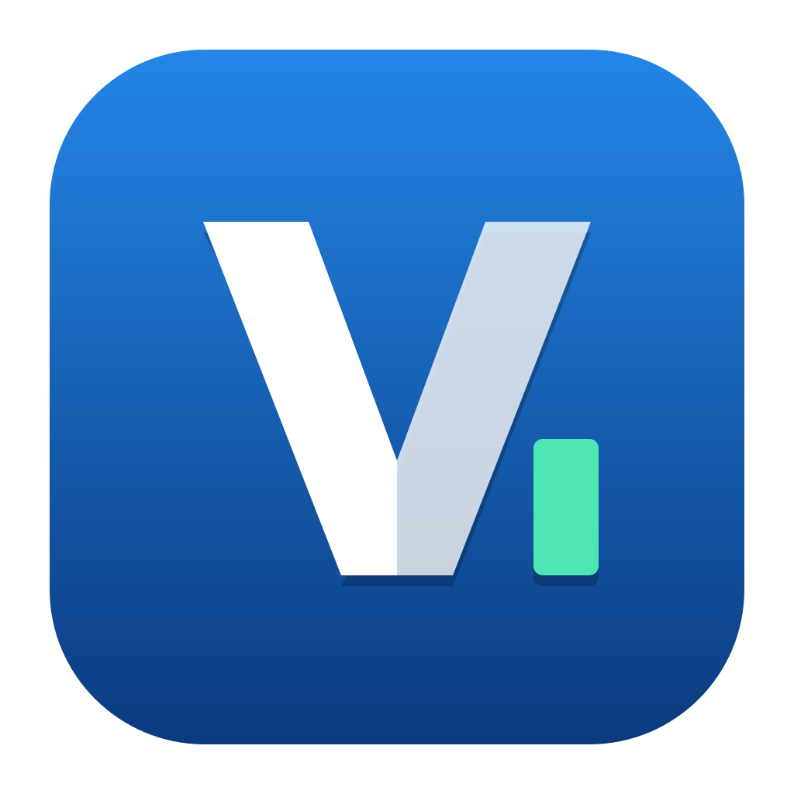

<p align="center"></p>

# Vex

A fast code editor written in Rust. It looks like VS Code and edits like Vim.

Vex draws its UI on the GPU with [egui](https://github.com/emilk/egui). It has the VS Code layout (activity bar, file explorer, tabs, breadcrumbs, minimap, status bar) in VS Code's Dark Modern and Light Modern colors, with the classic Dark+ and Light+ also available. A modal editing engine is built in from the start.

## Download

Prebuilt packages for each release are on the [Releases page](https://github.com/i1288/Vex/releases/latest):

| Platform | File | How to run |
|---|---|---|
| **Windows** (x64) | `vex-…-windows-x86_64.zip` | Unzip and run `vex.exe`. Windows SmartScreen may warn because the app isn't code-signed: click *More info → Run anyway*. |
| **macOS** (Apple Silicon and Intel) | `vex-…-macos-universal.zip` | Unzip and drag `Vex.app` into Applications. It isn't notarized, so the first time, right-click it and choose *Open*. |
| **Linux** (x86_64) | `vex-…-linux-x86_64.tar.gz` | Extract and run `./vex`, or run `./install.sh` to install it to `~/.local/bin` with an app-menu entry. |

To publish a new release, push a version tag (`git tag v0.2.0 && git push origin v0.2.0`). The [release workflow](.github/workflows/release.yml) then builds all three packages on GitHub's machines and attaches them to the release.

## Build from source

```bash
cargo run --release              # open the current folder
cargo run --release -- path/     # open a folder
cargo run --release -- file.rs   # open a file (its folder becomes the workspace)
```

## Modes

The status bar badge shows the current mode: **NORMAL**, **INSERT**, **VISUAL** / **V-LINE**, **COMMAND**.

| Normal mode | |
|---|---|
| `h j k l`, arrows | move |
| `w b e` / `W B E` | word forward / back / end |
| `0 ^ $` | line start / first non-blank / end |
| `gg G` `{N}G` | top / bottom / line N |
| `{ }` `%` | paragraph / matching bracket |
| `f t F T` + char, `;` `,` | find on line, repeat |
| `Ctrl-d Ctrl-u Ctrl-f Ctrl-b` | half page / page |
| `i a I A o O` | enter insert mode |
| `x X D C s S r J ~` | quick edits |
| `d c y > <` + motion | operators (`dw`, `c$`, `y}`, `>j` …) |
| `dd cc yy >> <<` | whole lines |
| `iw aw i" a" i( a( i{ a{ i[ i<` | text objects (`ciw`, `di(`, `ya"` …) |
| `p P` | paste after / before |
| `u` / `Ctrl-r` | undo / redo |
| `.` | repeat last change |
| `/ ?` `n N` `* #` | search (regex, smartcase) |
| `v V` | visual / visual line |
| `gt gT` | next / previous tab |
| `]d` `[d` | next / previous error or warning |
| `Ctrl-w h/l` `Ctrl-w w` | focus pane left / right / next |
| `Ctrl-w v` `Ctrl-w q` `Ctrl-w o` | split / close / keep only this pane |
| counts | `3dw`, `5j`, `2dd` … |

| Command line (`:`) | |
|---|---|
| `:w [file]` `:wa` | save |
| `:q` `:q!` `:wq` `:x` | close tab (quits when no tabs are open) |
| `:qa` `:qa!` `:wqa` | quit all |
| `:e <file>` | open file |
| `:N` | go to line N |
| `:s/a/b/g` `:%s/a/b/gi` | replace (regex; `$1`/`\1` groups, `\n` splits lines) |
| `:noh` | clear search highlight |
| `:bn` `:bp` | next / previous tab |
| `:set …` `:settings` | change options / open the Settings page |
| `:nnoremap` `:inoremap` … `:source` | mappings and scripts (see below) |
| `:terminal` `:files` `:sidebar` `:keybindings` | app commands |
| `:vsp [file]` `:only` | split pane (side by side) / close other panes |

On macOS, use Cmd wherever this README says Ctrl, except for ``Ctrl+` `` (terminal) and `Ctrl+Tab`, which use the Control key as in VS Code.

| App shortcuts | |
|---|---|
| `Ctrl+Shift+P` / `F1` | command palette: every command, plus the theme picker |
| `Ctrl+P` | go to file (fuzzy) |
| `Ctrl+Shift+F` | search in files |
| `Ctrl+Shift+M` | problems panel |
| `Ctrl+S` | save |
| `Ctrl+B` | toggle sidebar |
| `Ctrl+\` | split editor |
| `Ctrl+1` … `Ctrl+5` | focus pane N |
| `Ctrl+Tab` / `Ctrl+PageDown` | next tab |
| `Ctrl+=` `Ctrl+-` `Ctrl+0` | zoom editor font |
| `Ctrl+,` | open the Settings page |
| `Ctrl+K` | keyboard shortcuts panel |
| `Alt+Z` | toggle word wrap |
| ``Ctrl+` `` | show / focus / hide the terminal |

Yanks are copied to the system clipboard, and `Ctrl+V` pastes from it. In the editor, `Ctrl+C` copies the selection in visual mode and acts as `Esc` otherwise.

In Insert mode, `(`, `[`, `{` and quotes add their closing half, typing the closing half steps over it, and `Backspace` in an empty pair removes both. The bracket at the cursor and its partner are highlighted. Turn these off in Settings → Editor → Brackets.

## Command palette

`Ctrl+Shift+P` (or `F1`) lists every command by name with its shortcut. Type a few letters to filter (`tt` finds *Toggle Terminal*); the ones you used last are at the top. Besides the app commands it can toggle line numbers, relative numbers, indent guides and breadcrumbs, save all files, reveal the current file in the explorer, and open `settings.toml` or `init.vex`. **Color Theme** lists the themes and previews each one as you move through them with the arrow keys; `Enter` keeps it and `Esc` goes back.

## Search in files

The search icon in the activity bar (or `Ctrl+Shift+F`) opens the **Search** view. Results appear as you type, grouped by file, with counts. The toggles in the box are **Aa** (match case), **ab** (whole word) and **.\*** (regular expression). Click a result to open the file at that line; the matches stay highlighted in the editor, so `n` and `N` step through them. Selecting text in visual mode before `Ctrl+Shift+F` searches for it. Build folders (`target`, `node_modules`, `.git`, …) and binary files are skipped.

## Git

In a git repository, Vex shows what changed since the last commit:

- **Gutter:** a green bar beside added lines, a blue bar beside changed lines, and a red wedge where lines were deleted. They update as you type, and also show as ticks on the scrollbar.
- **Explorer:** changed files are colored, with **M** (modified), **U** (untracked), **A** (added), **D** (deleted) or **R** (renamed) on the right. Folders with changes inside get a dot.
- **Status bar:** the current branch, with `↑` / `↓` counts when there are commits to push or pull.

Status refreshes every few seconds, after saving, and when you come back to the window. It needs `git` on your PATH.

## Problems

The bottom panel has a **Problems** tab next to the terminal, listing every syntax and type error in the open files, grouped by file. Click one to go to it. Open it with `Ctrl+Shift+M` or by clicking the error count in the status bar.

## Sessions

When you close Vex, it remembers the files you had open in that folder: the panes, the tabs and where the cursor was in each. Opening the folder again brings them back. Opening a single file (`vex file.rs`) starts fresh. Turn it off in Settings → Files, or with `restore_session = false`.

## Syntax checking

Vex underlines syntax errors as you type in **Rust, Python, JavaScript, TypeScript/TSX, C, C++, Go, Java, JSON, Bash, CSS, HTML, TOML and YAML**. It uses [tree-sitter](https://tree-sitter.github.io/) grammars built into Vex, so nothing extra needs to be installed. Checking runs on a background thread a moment after you stop typing, and only for files that changed. A 9,000-line file takes about 20 ms.

- A red squiggle marks each error. Hover over it, or put the cursor on its line, to read the message in the status bar.
- The status bar shows the error count for the current file. Click it to open the Problems panel, or use `]d` / `[d` to jump to the next or previous error.
- Files with errors get a red tab name and red marks on the scrollbar.
- Turn it off in Settings → Editor → Syntax checking, with `syntax_check = false`, or with `:set nosyntaxcheck`.

It catches syntax mistakes: unclosed brackets, stray tokens, missing `;`, broken JSON.

### Type checking (language servers)

For type errors, unknown names, wrong arguments and the like, Vex uses the same **language servers** VS Code does. A server starts automatically when you open a file it handles, as long as it's installed:

| Language | Server | Install |
|---|---|---|
| Rust | rust-analyzer | `rustup component add rust-analyzer` |
| Python | basedpyright, pyright or pylsp | `pip install basedpyright` |
| JavaScript / TypeScript | typescript-language-server | `npm i -g typescript typescript-language-server` |
| C / C++ | clangd | your package manager (`apt install clangd`, `brew install llvm`) |
| Go | gopls | `go install golang.org/x/tools/gopls@latest` |
| Bash | bash-language-server | `npm i -g bash-language-server` |
| Java | jdtls | Eclipse JDT Language Server |

Errors get red squiggles and warnings yellow ones, in the same places as syntax errors. While a server starts up or indexes, its progress shows in the status bar. Settings → Editor → Type checking shows which servers Vex found. Turn it off with `type_check = false` or `:set notypecheck`. To use a different server, or to turn one off, set its command in `settings.toml`:

```toml
[language_servers]
python = "pylsp"
go = ""          # don't start gopls
```

When you open a single file, Vex opens its project too: the nearest folder above it with a `Cargo.toml`, `package.json`, `pyproject.toml`, `go.mod` or `.git`.

## Other keyboard layouts (Colemak, Dvorak, AZERTY…)

Turn on **Settings → Keyboard → Vim keys by position** (or `vim_key_positions = true`, or `:set physicalkeys`). Vim commands then follow where a key sits on a US QWERTY keyboard, whatever layout you type with. On Colemak, the keys under your right hand stay `h j k l`, and `dd`, `yy`, `:` and the rest are where vim users expect them.

Anything that is text still uses your layout: typing in Insert mode, `:` commands, `/` searches, and the character after `f`, `t`, `F`, `T` and `r` (so `fe` finds a real "e"). Mappings in `init.vex` and the panel are written in QWERTY terms when this is on.

## Custom shortcuts and mappings

**Keyboard Shortcuts panel.** The gear icon at the bottom of the activity bar (or `Ctrl+K`, or `:keybindings`) opens a panel with two tabs:

- **Shortcuts:** every app command and its keys. Click **Change**, press the keys you want, and it's saved. If those keys were used by another command, that command loses them and the panel tells you. **Reset** brings back the default.
- **Vim Mappings:** make keys do something else without writing a script. Pick a mode, type what you press (like `<Space>w`) and what it should do (like `:w<CR>`). There are one-click examples to start from.

Both are saved to `keybindings.toml` in the Vex config folder.

**init.vex scripting.** For Vim users, `init.vex` in the same folder runs at startup like a `.vimrc`. Each line is a `:` command, and saving the file in Vex reloads it. The panel's **Open init.vex** button creates it with examples.

```vim
" ~/.config/vex/init.vex
let mapleader = "<Space>"
inoremap jk <Esc>
nnoremap <Leader>w :w<CR>
nnoremap <Leader>t :terminal<CR>
nnoremap <Leader>f :files<CR>
vnoremap < <gv
set relativenumber
```

Supported: `map` / `noremap` and their `n`, `i`, `v`/`x` variants, `unmap`, `mapclear`, `let mapleader`, `source <file>`, `set`, and any other `:` command. Key notation: `<CR>` `<Esc>` `<Tab>` `<BS>` `<Space>` `<Leader>` `<C-x>` `<lt>` and the arrows. The same commands work at the `:` prompt for the current session. Running `:nmap` lists the active mappings.

Commands useful in mappings: `:terminal`, `:files` (Go to File), `:sidebar`, `:keybindings`, `:vsplit`, `:w`.

## Terminal

``Ctrl+` `` opens your `$SHELL` in a panel below the editor (the Terminal tab, next to Problems), started in the workspace folder. Press it again to hide the panel, or click the editor to switch focus. It's an xterm-compatible terminal with 256-color and true-color support, so full-screen programs like `less`, `htop` and `vim` work. While it has focus, `Ctrl+C` interrupts the running program, `Ctrl+V` pastes, and the mouse wheel scrolls back through history.

## Settings

The **Settings page** (gear icon at the bottom left, `Ctrl+,`, or `:settings`) has every option, with a search box and these sections:

- **Appearance:** interface size, editor font (any monospace font on your computer), font size, line height, cursor style and blinking
- **Theme & Colors:** pick a theme from preview cards, change any single color with a color picker, or save the result as a new theme
- **Editor:** tab size, spaces or tabs, word wrap, minimap, line numbers (absolute or relative), indent guides, bracket matching and auto-closing, current-line highlight, visible whitespace, breadcrumbs, scroll margin
- **Files:** auto-save (with a delay), trim trailing whitespace on save, restoring the open files
- **Terminal:** font size and which shell to run
- **Keyboard:** links to the Keyboard Shortcuts panel and to `init.vex`

Changes apply immediately and are saved to `~/.config/vex/settings.toml`, a commented file you can also edit directly (`:settingsfile`). `:set` changes options for the current session only, like Vim: `:set wrap`, `:set nominimap`, `:set ts=2`, `:set noet`, `:set rnu`, `:set list` (show whitespace), `:set nu!` (toggle), `:set ts?` (show), `:set` (show all), `:colorscheme dracula`.

### Themes

Built in: **Dark Modern** and **Light Modern** (the defaults), **Dark+** and **Light+** (classic), **Monokai**, **Dracula**, **One Dark**, **Nord**, **Gruvbox Dark**, **Tokyo Night**, **Catppuccin Mocha**, **Solarized Dark**, **Solarized Light** and **GitHub Light**.

Your own themes are `.toml` files in `~/.config/vex/themes/`. Each one starts from a built-in theme and changes whichever colors you list; the Settings page shows every color name. The **Save theme** button in Settings writes one for you from the current colors.

```toml
# ~/.config/vex/themes/midnight.toml
title = "Midnight"
base = "tokyo-night"

[colors]
editor_bg = "#0b0c14"
keyword = "#ff6ac1"
accent = "#ff6ac1"
```

To tweak a theme without making a new one, add colors under `[colors]` in `settings.toml`, or use **Customize colors** in the Settings page.

## Layout

```
src/
  main.rs      entry point, CLI args
  app.rs       window layout, input routing, overlays
  view.rs      editor view: text drawing, soft wrap, mouse
  workspace.rs open buffers, split panes, per-tab cursor and scroll
  terminal.rs  pty-backed shell and xterm key encoding
  vim.rs       modal editing engine (GUI-independent, unit tested)
  buffer.rs    text buffer, file I/O, undo/redo
  syntax.rs    keyword-based syntax highlighting
  diagnostics.rs  tree-sitter syntax checking on a background thread
  lsp.rs       language server client for type checking
  explorer.rs  file tree and fuzzy file finder
  search.rs    search in files (the Search view), on a background thread
  palette.rs   the command palette and theme picker
  git.rs       git status, branch, and line diffs against HEAD
  session.rs   saving and reopening the open files per folder
  icons.rs     painted icons and small shared widgets
  settings.rs  settings file and :set options
  settings_page.rs  the Settings page
  keymap.rs    vim key notation and mapping table
  commands.rs  app commands and configurable shortcuts
  keys_panel.rs  the Keyboard Shortcuts panel
  theme.rs     built-in themes, theme files, color overrides, fonts
  snapshot.rs  dev aid: VEX_SNAPSHOT=out.png VEX_KEYS='…' saves a screenshot
               (on Wayland, run it with WAYLAND_DISPLAY unset)
```

Run the tests with `cargo test`.

Other folders:

```
assets/      logo (SVG) and app icons, generated by scripts/make_icons.py
packaging/   Linux .desktop entry and installer, macOS Info.plist
scripts/     icon generator and release packaging scripts
```

Patterns use Rust [regex syntax](https://docs.rs/regex/latest/regex/#syntax). A pattern that isn't valid regex is matched as plain text, so `/f(` still works.
